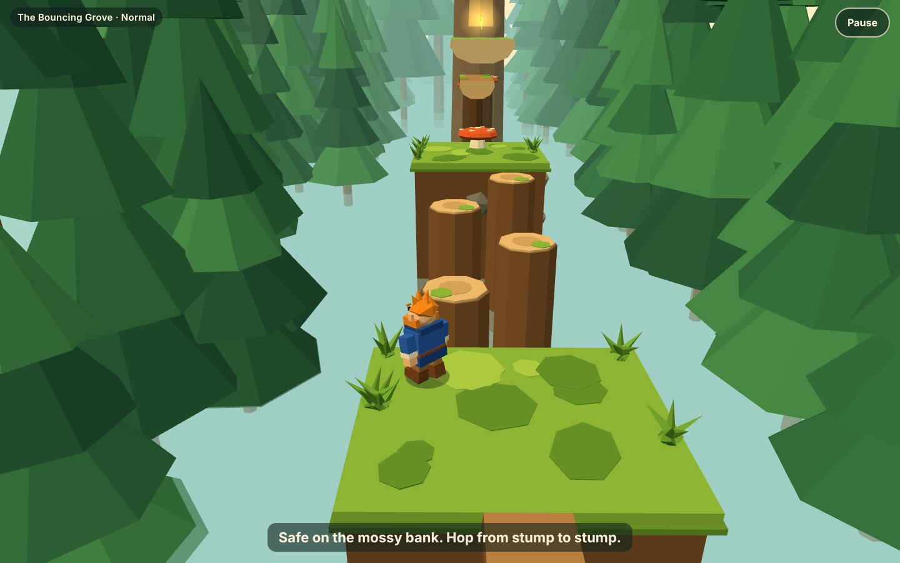
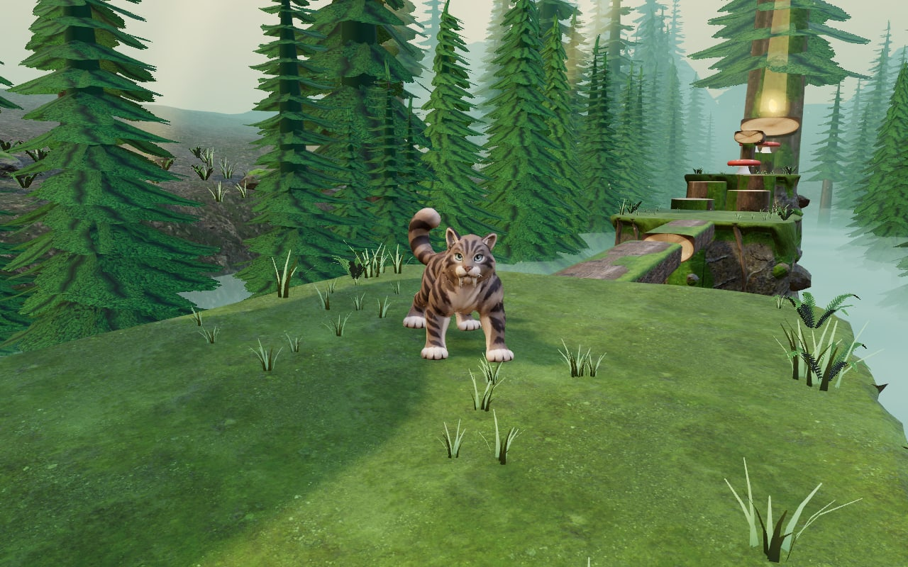

# Yaarbroverse 3D

A 3D browser game set in the Yaarbroverse, the sibling of the 2D game Caputo Mountain. Made for two kids: one who finds games too easy and one who finds them too hard, so every level has Easy, Normal and Hard.

**The first area: the Bouncing Grove.** Six sections, about a minute for a perfect run: cross the broken logs, hop the stumps, climb down into the ravine and out, bounce up the mushrooms, walk the high boughs, and climb to the golden leaf, tucked in the canopy. Play as Yaarbro or Caputo.





The grove is a lit, textured forest: mossy banks of rock, fallen logs, stumps with cut rings, mushroom springs, firs with real boughs, grass that sways, mist in the gully below and sunlight through the leaves. Yaarbro and Caputo are rigged, textured models that walk, run, jump and land.

## Play

**https://rowbeartow.github.io/yaarbroverse-3d/**

The link is live. Every change merged to `main` is published there within a few minutes.

The start screen shows straight away, with a progress bar while the grove loads (about 7 MB).

- **Mac:** arrow keys or W A S D to move, Space to jump (hold for a higher jump), X or Shift for the hero's own move (hold it for Yaarbro's roll, press it for Caputo's pounce), Esc to pause.
- **iPad:** hold it sideways. Left thumb moves, right thumb jumps. The smaller round button above Jump is the hero's own move.

A fall puts you back on the last safe mossy bank. On Easy and Normal every bank is safe; on Hard only some are.

### Switch on the link (owner, one time, already done)

1. Open https://github.com/rowbeartow/yaarbroverse-3d/settings/pages
2. Under **Build and deployment**, open the **Source** menu and choose **GitHub Actions**. There is no Save button; it saves by itself.
3. Open https://github.com/rowbeartow/yaarbroverse-3d/actions/workflows/publish.yml
4. Click **Run workflow** (right side), leave the branch as `main`, and click the green **Run workflow** button.
5. Wait about two minutes for the green tick, then open https://rowbeartow.github.io/yaarbroverse-3d/

If the address is different on your account, the real one is shown at the top of the page from step 1 once the first publish has finished.

### Put it on an iPad

1. On the iPad, open **Safari** and go to `rowbeartow.github.io/yaarbroverse-3d`.
2. Tap **Share** (the square with an up arrow; on newer iPads it can be inside the **•••** menu), then **Add to Home Screen**, then **Add**.
3. Open the new **Bouncing Grove** icon. It opens full screen.
4. Turn the iPad sideways, pick a hero and a difficulty, tap **Play**. The iPad remembers the choices.

If the game says "Turn sideways to play" while the iPad is already sideways, rotation lock is on: swipe down from the top-right corner and tap the lock button with the arrow around it.

## How well it runs

The game chooses its own picture quality: it starts high on a computer and medium on an iPad, watches the frame rate, and steps down if it cannot hold 60 frames a second on a computer or a steady 30 on an iPad.

- To see the frame rate and the quality tier, add `?fps` to the address: https://rowbeartow.github.io/yaarbroverse-3d/?fps
- To fix the tier, add `?quality=high`, `medium`, `low` or `minimal`.

## Change how hard it is

Every Easy, Normal and Hard number for the grove is in one file: [src/levels/bouncing-grove/difficulty.ts](src/levels/bouncing-grove/difficulty.ts). Each number has a plain-words note. After a change, `npm test` plays all three difficulties start to finish and fails if one has become impossible.

## For agents and developers

Start with [CLAUDE.md](CLAUDE.md). Current state and next step: [docs/session-handoff.md](docs/session-handoff.md). Decisions: [docs/decisions.md](docs/decisions.md).

Node 22 (`.nvmrc`), then:

```sh
npm ci
npm run dev           # prepares the assets, then play locally at the address it prints
npm test              # game rules, no browser
npm run build         # production build into dist/, with a download size check (20 MB)
npm run test:browser  # keyboard, touch and look checks in Chromium and WebKit (Safari's engine)
```

Source textures, the forest light and models live in `assets/`. The build compresses them into `public/media/` (KTX2 textures, meshopt geometry), which is not committed.

The hero models in `assets/heroes/` and the enemy models in `assets/enemies/` are kept already compressed. The owner's original files are too big for this repo. Three tools in `tools/` make the small files from them, each explained at its top: `prepare-rigged.py` (Blender) puts Yaarbro's clips on one model and cleans up his skin, `rig-quadruped.py` (Blender) gives Caputo his skeleton and clips, and `compress-hero.mjs` compresses the result.

## Rights and credits

The Yaarbroverse, its characters and their art are all rights reserved. That includes the hero models in `assets/heroes/` and the enemy models in `assets/enemies/`, which were made from the Caputo Mountain art: they are not CC0 and are not free to copy or reuse.

Every third-party file in this repo is CC0 and is listed with its source in [CREDITS.md](CREDITS.md).
